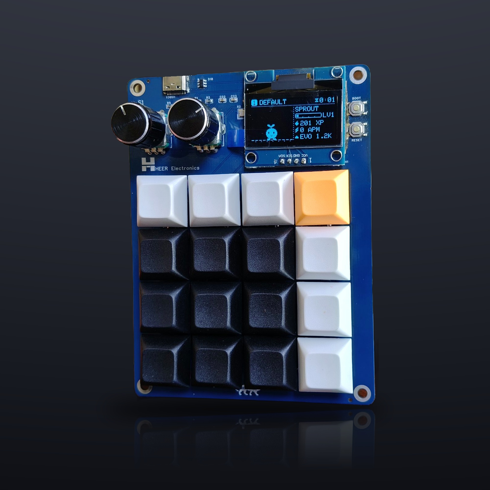

# HEER S1 Macropad

A compact RP2040-based macropad with dual rotary encoders, 1.3" OLED display, and Vial firmware. Designed and assembled by **HEER Electronics**, Rajasthan, India.

  

## Features

- RP2040 microcontroller (dual-core ARM Cortex-M0+, 133 MHz)
- 16x MX-compatible key switches
- 2x EC11 rotary encoders with push
- 1.3" SH1106 OLED display (I2C)
- Vial firmware — remap keys live at vial.rocks, no software install needed
- USB-C with ESD protection (USBLC6-2SC6)
- W25Q128 16MB QSPI flash
- 3.3V LDO power regulation (ME6211)

## Hardware
**Schematic**
https://github.com/heerelectronics/HEER-S1/blob/main/Hardware/Schematic.pdf  
**BOM**
https://github.com/heerelectronics/HEER-S1/blob/main/Hardware/BOM.xlsx  
**Netlist**
https://github.com/heerelectronics/HEER-S1/blob/main/Hardware/netlist.txt

| Component | Part | Notes |
| --- | --- | --- |
| MCU | RP2040 LQFN-56 | 0.4mm pitch |
| Flash | W25Q128JVSIQ SOIC-8 | 16MB QSPI |
| Crystal | YSX321SL 12MHz | CL = 12pF |
| Load caps | 18pF C0G 0603 | C4 and C5 |
| LDO | ME6211 | 3.3V 500mA |
| ESD | USBLC6-2SC6 | USB-C protection |
| Display | SH1106 1.3" OLED | I2C 128x64 |
| Switches | MX-compatible | 16x |
| Encoders | EC11 | 2x |

## Firmware

This macropad runs Vial, an open-source fork of VIA.

### Flash firmware

1. Hold BOOT button and plug in USB-C
2. A drive named RPI-RP2 appears on your computer
3. Drag and drop the .uf2 firmware file onto the drive
4. Board reboots automatically

### Remap keys

Open vial.rocks in Chrome or Edge. No software install needed. All 16 keys and 2 encoders are fully remappable.

## License

Firmware is released under the MIT License.

Hardware design files (PCB, Gerbers) are proprietary and not published. The schematic PDF, BOM, top plate DXF, and 3D case files are shared for reference and personal use.

## About

HEER Electronics is an independent electronics brand based in Rajasthan, India, building open-source keyboard hardware.

- Issues and questions: open a GitHub issue
- Made in India
